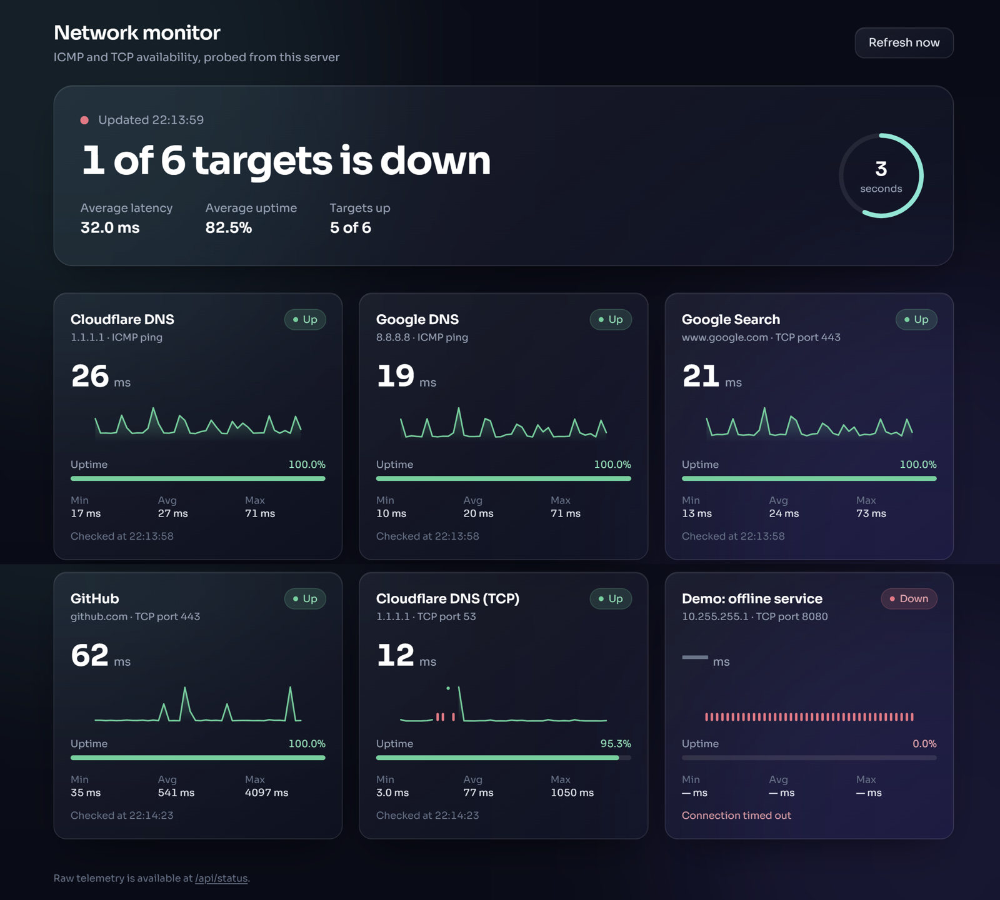

# Network Monitor

A real-time network and service availability dashboard built with Flask. It probes hosts using ICMP ping and TCP port checks, tracks latency and uptime, and shows everything on a dark glassmorphic dashboard that refreshes itself every 5 seconds.

Built as a mini project for the Honours course in **Advanced Computer Networks**. The goal was to apply core networking ideas (ICMP echo, TCP connection handshakes, round-trip time and availability measurement) in a small working tool, so the project stays deliberately simple: no database, no authentication and a single process.



## Features

- **ICMP and TCP probes** run on a background thread, in parallel, so one slow host never delays the others
- **Latency (RTT) tracking** with latest, minimum, average and maximum values per target
- **Uptime percentage** per target, plus a sparkline of recent latency with failed checks marked in red
- **Status levels**: Up, Slow (RTT above a threshold), Down and Checking
- **JSON telemetry API** at `/api/status`
- **Live dashboard** built with Tailwind CSS that updates through `fetch` without reloading the page, and shows a warning banner if the API becomes unreachable
- **One-command deployment** with Docker Compose
- **Configurable** targets, interval, timeout and thresholds through environment variables

## Tech stack

| Layer | Technology |
|-------|------------|
| Backend | Python 3.12, Flask, Gunicorn |
| Probes | System `ping` (ICMP), `socket` (TCP) |
| Frontend | HTML, Tailwind CSS (CDN), vanilla JavaScript |
| Deployment | Docker, Docker Compose |

## How it works

```
 background thread (every CHECK_INTERVAL seconds)
        |
        |-- ICMP probe --> system ping --> parse RTT
        |-- TCP probe  --> socket connect --> time the handshake
        v
 in-memory state per target (history, uptime, min/avg/max)
        |
        v
 Flask  GET /api/status  --> JSON
        ^
        |  fetch() every 5 s
 Browser dashboard (templates/index.html)
```

## Project structure

```
network-monitor/
├── app.py                 # Flask app, probes and background monitor thread
├── templates/
│   └── index.html         # Dashboard UI
├── docs/
│   └── screenshot.png
├── requirements.txt
├── Dockerfile
├── docker-compose.yml
├── .dockerignore
├── .gitignore
├── LICENSE
└── README.md
```

## Quick start (Docker)

Requires Docker Desktop (or Docker Engine with the Compose plugin).

```bash
git clone https://github.com/nishitatanna2028-source/network-monitor.git
cd network-monitor
docker compose up --build
```

Then open [http://127.0.0.1:5000](http://127.0.0.1:5000)

> The server logs show `0.0.0.0:5000`, but that is only the address it listens on. Always browse to `localhost` or `127.0.0.1`.

Stop it with `Ctrl+C`, or `docker compose down` if it is running in the background.

## Run without Docker

You need Python 3.10+ and the `ping` command available on your system.

**Windows (PowerShell or CMD)**
```bat
python -m venv venv
venv\Scripts\activate
pip install -r requirements.txt
python app.py
```

**Linux / macOS**
```bash
python3 -m venv venv
source venv/bin/activate
pip install -r requirements.txt
python app.py
```

Then open [http://127.0.0.1:5000](http://127.0.0.1:5000).

## Configuration

Set these in the `environment` section of `docker-compose.yml`, or as normal environment variables when running locally.

| Variable | Default | Description |
|----------|---------|-------------|
| `CHECK_INTERVAL` | `5` | Seconds between probe rounds |
| `CHECK_TIMEOUT` | `2` | Timeout for each probe, in seconds |
| `HISTORY_LEN` | `40` | Number of samples kept for each sparkline |
| `DEGRADED_MS` | `250` | RTT above this value is shown as Slow |
| `MONITOR_TARGETS` | built-in list | JSON list of targets that replaces the defaults |

### Choosing what to monitor

Edit `DEFAULT_TARGETS` in `app.py`, or provide `MONITOR_TARGETS` as JSON:

```yaml
environment:
  MONITOR_TARGETS: '[{"name":"College Gateway","host":"192.168.1.1","type":"icmp"},{"name":"Web Server","host":"example.com","type":"tcp","port":443}]'
```

Each target needs `name`, `host` and `type` (`icmp` or `tcp`). TCP targets also need a `port`.

The default list includes **"Demo: offline service"**, an address that does not exist, so you can see how a Down target looks. Remove it from `DEFAULT_TARGETS` when you no longer need it.

## API

### `GET /api/status`

Returns the current telemetry for all targets.

```json
{
  "generated_at": "2026-10-29T16:41:13.512+00:00",
  "interval_s": 5.0,
  "rounds": 42,
  "summary": {
    "total": 6,
    "up": 5,
    "degraded": 0,
    "down": 1,
    "pending": 0,
    "avg_rtt_ms": 31.8,
    "avg_uptime_pct": 83.33
  },
  "targets": [
    {
      "id": "icmp-1.1.1.1-0",
      "name": "Cloudflare DNS",
      "host": "1.1.1.1",
      "type": "icmp",
      "port": null,
      "status": "up",
      "rtt_ms": 29.0,
      "avg_rtt_ms": 25.3,
      "min_rtt_ms": 18.0,
      "max_rtt_ms": 55.0,
      "uptime_pct": 100.0,
      "checks": 42,
      "failures": 0,
      "error": null,
      "last_checked": "2026-10-29T16:41:13.498+00:00",
      "history": [21.4, 19.8, 29.0]
    }
  ]
}
```

In `history`, `null` marks a failed check. The values above are illustrative.

### `GET /healthz`

Returns `{"ok": true}`. Docker uses it for the container health check.

## Notes and limitations

- **ICMP in Docker:** the image installs `iputils-ping` and the Compose file adds the `NET_RAW` capability. Some campus or corporate networks block ICMP, in which case ping targets show as Down while TCP targets still work.
- **Single worker:** Gunicorn runs with one worker because the monitor thread and its data live in the process memory. More workers would each run their own copy.
- **Data is in memory:** uptime and history reset when the app restarts. Adding a database such as SQLite would make them persistent.
- **Internet for the UI:** Tailwind and the Sora font load from CDNs, so the browser needs internet access to style the page.
- **Only monitor hosts you are allowed to probe.**

## Possible improvements

- Persist history in SQLite
- Alerts by email or Telegram when a target goes down
- Add and remove targets from the dashboard
- HTTP status-code checks alongside TCP and ICMP

## Author

Nishita Tanna - [github.com/nishitatanna2028-source](https://github.com/nishitatanna2028-source)

## License

Released under the [MIT License](LICENSE).
